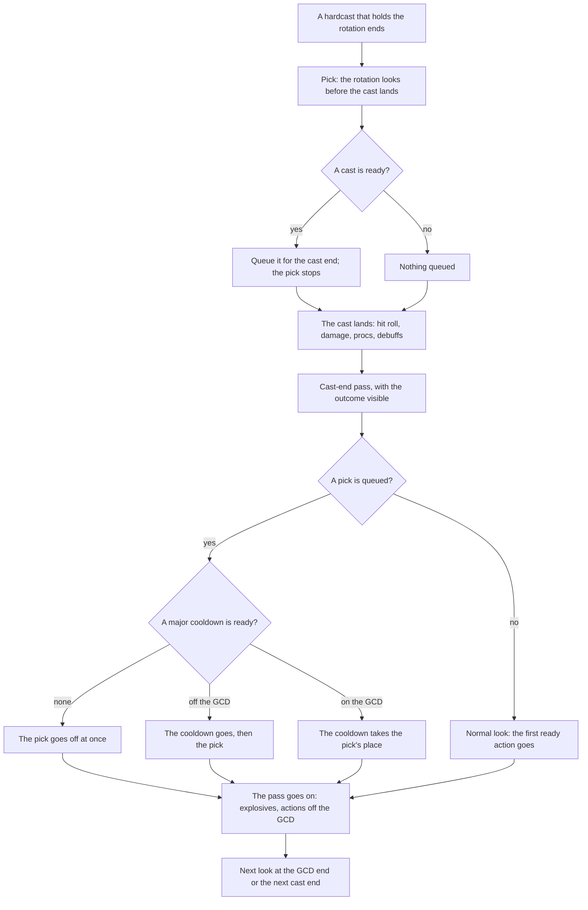

# The rotation at a cast end

The rotation (the APL) picks what follows a hardcast at the cast end, before the cast's outcome applies.
A player with spell queueing commits to the next cast before the current one lands and only sees the
result afterwards; the sim does the same.

## The flow

A hardcast holds the rotation when it is the player's, longer than the GCD and not a channel. Pets,
enemies, channels, casts the GCD outlasts and interactive sims decide after the cast lands, at the GCD
end. A prepull cast ending at the pull picks at 0, before it lands.

The major cooldowns the cast-end pass asks are the entries that can be one: Autocast Other Cooldowns,
a Cast Spell of a spell flagged as a major cooldown, and a group reference holding either. When none is
ready, the queued pick goes off without a scan of the list. The pick itself never queues a major
cooldown: every major cooldown decides at the cast end, with the outcome visible.

A Sequence, Strict Sequence or Strict Multidot step queued by the pick lets a major cooldown go ahead
of it in the same way.

## What the pick sees

The pick reads the running cast as landed as it was meant to:

| Read                                                                        | At the pick                                 |
| --------------------------------------------------------------------------- | ------------------------------------------- |
| The cast's own dot (`Dot Is Active`, `Dot Remaining Time`, Multidot)        | up, with a fresh duration from the cast end |
| The aura with the cast's own id (`Aura Is Active`, `Aura Remaining Time`)   | up; a stacking aura has one stack more      |
| The cast's cooldown and shared cooldown (`Spell Is Ready`, `Time To Ready`) | running from the cast end                   |
| `Current Mana`, `Current Mana %`                                            | after the cast's cost                       |
| `Spell Is Casting` of that spell                                            | true                                        |
| Everything that happened before the cast end                                | as it is                                    |
| A dot or aura that runs out at the cast end                                 | down                                        |

It does not see what the landing decides: the hit roll, the damage, a proc the landing triggers, a
stack it adds to or takes from an aura with another id, a debuff with another id.

## Which lines need `Spell Is Casting`

A line that refreshes the cast's own dot needs nothing: `Cast Immolate if not(Dot Is Active(Immolate))`
and a Strict Multidot read the running Immolate as landed and wait.

A line that reads an aura with another id, which the running cast will change when it lands, re-queues
the same spell unless it is guarded with `not(Spell Is Casting(X))`:

| Line                                                   | Why the guard                            |
| ------------------------------------------------------ | ---------------------------------------- |
| Searing Pain if Demonic Brand is down                  | the brand is a proc of the landing       |
| Pyroblast at 3 Heating Up stacks                       | the landing Pyroblast spends the stacks  |
| Scorch at 4 Fire Vulnerability stacks                  | the landing Scorch adds the fifth        |
| Arcane Blast when its buff is about to run out         | the landing Arcane Blast refreshes it    |
| Starfire on the last Eclipse stack                     | the landing Starfire spends it           |
| Hamstring when Windfury is down, while Slam is casting | Slam's landing puts the Windfury proc up |

Lines that must re-queue the spell behind itself stay unguarded: a filler (Shadow Bolt after Shadow
Bolt), Scorch while it builds the first four stacks, Arcane Blast while it builds its own stacks.

## Where this lives

- `sim/core/gcd.go`: `pickAtCastEnd` and `hardcastHoldsRotation`.
- `sim/core/spell_queueing.go`: the spell queued after the hardcast, `queuedSpellDue` and `castDueQueuedSpell`.
- `sim/core/apl.go`: the cast-end pass, `majorCooldownMayGo` and `isMajorCooldown`.
- `sim/core/apl_values_aura.go`: `readLanding`, the own dot and aura readings.
- `sim/core/spell.go`: `rotationTimeToReady`, the own cooldown reading.
- `sim/core/apl_values_spell.go`: `Spell Is Casting`.
